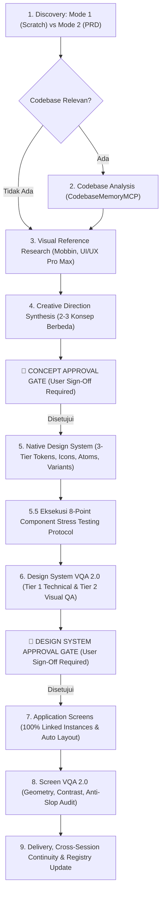

# Design Orchestrator 2.2

Design Orchestrator 2.2 is the unified meta-skill for end-to-end interface and product design in Antigravity. It coordinates consultative discovery, visual reference intelligence, dynamic creative direction, native FigCraft execution, 3-tier design tokens, atomic component hierarchies, and the **4-Dimensional Visual Quality Assurance (VQA) 2.0** verification engine.

> [!IMPORTANT]
> **Readiness Status**: `TECHNICAL_RUNTIME_PASS / READY_FOR_CONTROLLED_PILOT`  
> Technical runtime mechanics (3-tier variable cascade, save/reload persistence, idempotent recipes, and multi-page linked instances) are 100% verified. Aesthetic craft quality requires multimodal VQA 2.0 evaluation and human approval at the hard stops.

---

## 1. Progressive Disclosure Reference Map

Load only the specialized reference required for the current stage:

| Stage & Scope | Responsibility | Reference File to Read |
|---|---|---|
| **Discovery & Scoping (Stage 1)** | PRD ingestion, consultative interviews, project routing | [references/workflow-details.md](references/workflow-details.md) |
| **Codebase Analysis (Stage 2)** | Codebase graph querying, token discovery, tool precedence | [references/conflict-resolution.md](references/conflict-resolution.md) |
| **Research & Direction (Stage 3–4)** | 7-facet intelligence, 10 mandatory dimensions, divergence | [references/creative-direction.md](references/creative-direction.md) |
| **Native Design System (Stage 5)** | 3-tier tokens, vector icons, master components, 8-point stress test | [references/component-architecture.md](references/component-architecture.md) |
| **Canvas Quality Assurance (Stage 6, 8)** | 4-Dimensional VQA 2.0, WCAG 2.2 contrast, geometry verification | [references/visual-qa-system.md](references/visual-qa-system.md) |
| **Application Screens (Stage 7)** | Reusable linked instances, locked columns, responsive reflow | [references/component-architecture.md](references/component-architecture.md) |
| **Project Design System Scaffold** | Single source of truth blueprint for `projects/<slug>/DESIGN.md` | [references/design-template.md](references/design-template.md) |

---

## 2. Core Principles

1. **Evidence-Based QA & Zero False PASS**: Executing commands or taking screenshots is NOT proof of correct design. PASS requires 0 P1/P2 defects across Tier 1 (Technical Integrity) and Tier 2 (Visual Quality). Results labeled `UNKNOWN` or `NOT_VERIFIABLE` must NEVER be declared PASS.
2. **Native Reusable Components vs. Page Layout Shells**: All repeating UI controls (`Button`, `Badge`, `Input`, `Table/Row`, `Card`) **MUST** be native linked instances (`INSTANCE`). Structural page viewports, columns, and body containers **MUST** be native Frames with Auto Layout (`FRAME`). Never wrap an entire page into a rigid component.
3. **Domain-Driven Modular Artboard Architecture**: Adapt artboards to product scope (3–4 for utility apps; 5–10+ for enterprise suites). Every artboard requires a title header card matching its width and $\ge 24\text{px}$ clearance above component sets.
4. **Creative Direction, Tactile Depth & Anti-Monotony**: Reject generic AI purple glows and sterile grey defaults. Layer soft structural boundaries (`#E2E8F0`) with tactile micro-elevation and clear surface modes (`Operate`, `Persuade`, `Read`, `Experience`).
5. **Semantic Color Harmony & Brand Dominance**: The primary brand color must dominate the canvas. Accent and status colors are strictly forbidden on primary button backgrounds. Status fills must be subtle tints, never blinding full-saturation floods.
6. **Icon State & Color Inheritance Matrix**: Vector icons must inherit stroke/fill colors from their parent container state (e.g. white on primary button, muted slate on disabled).
7. **Central Vector Icon Library & Instance Swapping**: Emojis (📅, 🔍, ⚙️, 👤) are strictly banned. Maintain crisp SVG vector paths (`20x20` or `24x24px`, stroke $1.5-2.0\text{px}$) with `fill: "none"` in `01_Foundations`. Controls embed nested linked instances.
8. **Legibility Floor & Typography Scale**: Minimum body text is $13-14\text{px}$; minimum micro/caption text is $11-12\text{px}$. Never shrink typography below $11\text{px}$ to fit table rows. Maintain distinct scales for Headings, Body, Captions, and Buttons.
9. **Design System First & Mandatory Approval Gate**: Partition documents into `01_Foundations`, `02_Components`, `03_Patterns`, and `04_Screens`. **🛑 DESIGN SYSTEM APPROVAL GATE**: Stop and wait for explicit user approval before designing screens.
10. **Strict State Separation**: Populated, empty, loading, and error states must never be collaged into the same viewport.
11. **Single Source of Truth (`projects/<slug>/DESIGN.md`)**: Exactly one `DESIGN.md` per project holds all tokens, creative direction, icon state matrices, component property registers, and VQA logs.
12. **Domain Realism & Data Integrity**: All metrics, KPIs, and labels must reflect realistic domain physics and units. Tag all placeholder data with `[SIMULASI]`.
13. **Locked Column Grid Precision**: In tabular views, headers and rows must share identical column widths and horizontal anchors ($|\Delta x| \le 1\text{px}$).
14. **Multi-Project Scoping & Document Isolation**: Every project is self-contained in `projects/<project-slug>/`. Inspect and open the primary `.figcraft` file explicitly to prevent accidental mutations on external files.
15. **PRD-Driven Functional Truth**: The PRD is the authoritative functional source. Never re-ask questions answered in the PRD; systematically map requirements in `REQUIREMENTS_MAP.md`.
16. **Visual Reference Research & Privacy**: Curate 3–5 verified benchmarks via Mobbin, UI/UX Pro Max, or browser research. Never send confidential PRD text or PII to external platforms.
17. **Natural Consultative Discovery Protocol**: Maximum 1–2 questions per turn with consultative framing and 1 primary recommendation. Resolve system needs and user roles before discussing visual styling.
18. **3-Tier Design Tokens & Native Variables**: Structure tokens across Tier 1 (Primitives), Tier 2 (Semantic Aliases), and Tier 3 (Component Tokens). Bind via `variable.bind`.
19. **Figma Import Fidelity Awareness**: Distinguish data structure import from visual rendering fidelity. external Figma files are architectural references, not assets to clone. Always inspect unselected screenshots.
20. **Component Specifications & 8-Point Stress Testing**: Every critical component must pass the 8-Point Component Stress Testing Protocol (Propagation, Overrides, Variants, Icons, Content Stress, Permutations, Sizing, Save/Reload).
21. **Non-Cloning & Adaptive Direction Mandate**: Never blindly clone reference UI kits. Adapt styling and density to specific project personas and domain constraints.
22. **Text Overflow & Critical Information Preservation**: Text handling must NEVER obscure critical data. Use multi-line wrapping as default (`textAutoResize: "height"`, vertical auto-layout) and dynamic sizing (`sizingH: "hug"`). Truncation (`textAutoResize: "truncate"`) is restricted to auxiliary strings.
23. **Dynamic Creative Direction & Archetype Synthesis**: Synthesize creative direction from the 7 domain intelligence facets across 10 mandatory dimensions. Produce 2–3 divergent concepts. **🛑 CONCEPT APPROVAL GATE**: Hard stop before canvas generation.

---

## 3. Component Activation Matrix

| Component | Responsibility | Activation Trigger | Primary Command / Tool |
|---|---|---|---|
| **Anti-Slop** | Quality Guardrail (R-01 to R-40, contrast, affordance) | Always active (Default `DURING`) | Rule audit against evidence; log in `DESIGN.md` |
| **Impeccable** | Visual Direction, Craft Floor, Surface Mode & Density | Stage 1 (Brief) & Stage 6/8 (Audit) | Evaluate typography scale, whitespace, micro-elevation |
| **UI/UX Pro Max** | Design Intelligence, Palettes, Font Pairings & Tokens | Stage 3 (Research) & Stage 4 (Concepts) | `python .agents/skills/ui-ux-pro-max/scripts/search.py "<query>" --design-system --json` |
| **CodebaseMemoryMCP** | Codebase Analysis, Schema Truth, Status Enums | Stage 2 (Codebase Analysis) | `call_mcp_tool(codebase-memory-mcp, search_graph / get_code_snippet)` |
| **Mobbin / browser-use** | Visual Reference Research & UI Benchmarking | Stage 3 (Visual Research) | `call_mcp_tool(mobbin_mobbin, search_screens)` / `browser-use` CLI |
| **NeedMCP (Optional)** | Secondary Cloud Style Benchmark | Stage 3/4 Exploration (`getStyle`) | `call_mcp_tool(needmcp, getStyle)` / `UNVERIFIED_RUNTIME` if unconfigured |
| **FigCraft MCP** | Native Canvas Execution, Stress Tests & Exports | Stage 5 through Stage 9 | `open_file`, `inspect_document`, `run_command`, `screenshot`, `save_file` |

---

## 4. Orchestration Workflow & Approval Gates

> [!CAUTION]
> **Mandatory Stop Rule**: An agent must NEVER automatically approve concepts or design systems on behalf of the user in production mode. Wait for explicit human confirmation at both **🛑 CONCEPT APPROVAL GATE** and **🛑 DESIGN SYSTEM APPROVAL GATE**.
