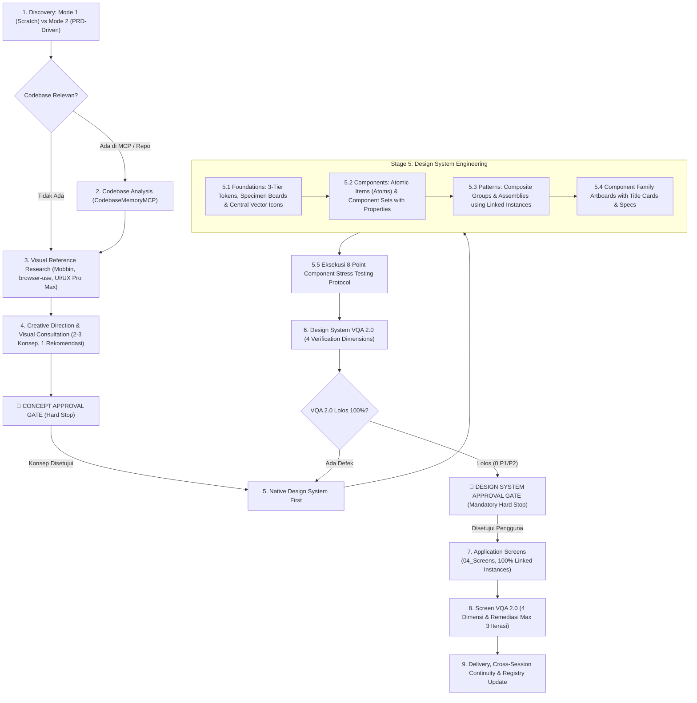

# Design Orchestrator 2.1

Design Orchestrator 2.1 is the unified meta-skill for end-to-end interface and product design in Antigravity. Informed by professional UI Kit architectures and real-world design systems, it bridges consultative discovery, visual reference intelligence, creative direction, native FigCraft execution, atomic component hierarchies, 3-tier design token engines, and the **4-Dimensional Visual Quality Assurance (VQA) 2.0** verification engine.

> [!IMPORTANT]
> **System Readiness Status**: `TECHNICAL_RUNTIME_PASS / READY_FOR_CONTROLLED_PILOT`  
> *Technical runtime mechanics (3-tier variable cascade, save/reload persistence, boolean properties, auto-layout flex, and multi-page linked instances) are 100% verified. Premium visual craft quality is subject to multimodal VQA 2.0 and requires end-to-end evaluation in controlled pilot projects.*

---

## 1. Core Principles

1. **Evidence-Based QA (Zero False PASS & Tiered Verification)**:
   - Executing FigCraft commands or taking screenshots is NOT proof of correct design.
   - Bounding box math ($\Delta x = 0$) alone is NOT proof of visual harmony.
   - **PASS** is granted ONLY when both Tier 1 (Automated Technical Verification) and Tier 2 (Multimodal Visual Evaluation) succeed with ZERO P1/P2 defects, supported by clean screenshots and the 8-Point Stress Test.
   - Defect severity is classified strictly by **actual user impact** (P1 Blocker, P2 Major Degradation, P3 Cosmetic Polish). Subjective aesthetic nuances must never be marked as P1.
2. **Native Reusable Components vs. Page Layout Shells**:
   - **Reusable UI Elements**: All repeating controls, atoms, molecules, and operational patterns (`Button`, `Badge`, `Input`, `Navbar`, `Table/Row`, `Card`) **MUST** use native linked instances (`instance.create`). Plain frames mimicking components are strictly prohibited.
   - **Page Composition & Layout Shells**: Page viewports, grid columns, main body wrappers, and sidebar layout shells **MUST** use native **Frames with Auto Layout** (`node.create {type: "frame", props: {layout: "vertical" | "horizontal"}}`). Never attempt to wrap an entire page into a rigid component instance.
   - **Atomic Component Progression**: Components follow Item (Atom) $\rightarrow$ Group (Molecule) $\rightarrow$ Pattern (Organism). Groups MUST compose linked instances of their atomic items.
   - Every reusable component must pass the **8-Point Component Stress Testing Protocol**.
3. **Domain-Driven Modular Artboard Architecture**:
   - Cramming all components onto a single artboard is strictly prohibited.
   - The number of component artboards must be **adaptive to product domain scope and complexity**, never rigidly restricted to an arbitrary fixed number:
     * *Focused / Utility Products*: 3–4 dedicated artboards (e.g. `Actions_Inputs`, `Navigation_Feedback`, `Data_Display`, `Instances_Showcase`).
     * *Enterprise / Multi-Workflow Suites*: 5 to 10+ dedicated artboards organized by component family (e.g. `Actions_Buttons`, `Selection_Controls`, `Form_Inputs`, `Navigation_Bars`, `Feedback_Indicators`, `Data_Tables`, `Overlays_Modals`, `Domain_Operational`, `Composite_Patterns`, `Instances_Showcase`).
   - **Spatial Cleanliness & Title Header Standard**: Each component family artboard must feature a standardized title header card matching the artboard width, providing name, category, and functional spec. Variant labels must maintain $\ge 24\text{px}$ clearance outside purple `COMPONENT_SET` bounding boxes.
4. **Creative Direction, Tactile Depth & Anti-Monotony**:
   - Reject generic AI templates (purple glows, radial orbs, skeleton cards) WITHOUT falling into sterile, lifeless grey defaults.
   - Anti-Slop serves as a **quality guardrail**, NOT a stylistic straightjacket that forces all designs to be flat or heavy border-first.
   - Implement proportional depth: soft structural boundaries (`#E2E8F0` or `#E5E7EB`) layered with tactile micro-elevation (`0 1px 2px rgba(0,0,0,0.05)` and hover lift `0 4px 6px -1px rgba(0,0,0,0.08)`). Where applicable, adopt **Dual Layered Elevation** (ambient soft blur + key directional shadow).
   - Maintain clear visual rhythm, intentional typographic contrast, and deliberate surface modes (`Operate`, `Persuade`, `Read`, `Experience`).
5. **Semantic Color Harmony & Brand Dominance**:
   - The primary brand action color must dominate the canvas.
   - Secondary or status colors (such as cyan, amber, or purple) are strictly forbidden from being placed as icons or accents directly on top of primary button backgrounds.
   - Semantic color roles (Success = Emerald, Progress = Sky Blue, Warning = Amber, Danger = Crimson, Neutral = Slate) must be strictly maintained across all components.
   - Avoid "status color flood": status fills must be subtle background tints, never blinding full-saturation containers.
6. **Icon State & Color Inheritance Matrix**:
   - Vector icons must strictly inherit color based on the parent component state (e.g. Primary button default/hover = white `#FFFFFF`, disabled = muted slate `#94A3B8`).
   - Never allow an icon to retain an arbitrary color that clashes with its container.
7. **Central Vector Icon Library & Instance Swapping**:
   - Strictly ban emojis (📅, 🔍, ⚙️, 👤) across all product UI elements.
   - Build a **Central Vector Icon Library** with crisp SVG vector paths (`vector.create`) in `01_Foundations` using standard bounding boxes ($20 \times 20\text{px}$ or $24 \times 24\text{px}$) and consistent stroke weight ($1.5\text{px}$ or $2.0\text{px}$).
   - Components requiring icons embed nested linked instances of icon masters, supporting native instance swapping (`instance.swap`) and boolean property toggles (`Icon Left`, `Icon Right`).
8. **Legibility Floor & Typography Scale**:
   - Minimum body text: $13\text{px}-14\text{px}$.
   - Minimum micro/caption text: $11\text{px}-12\text{px}$.
   - Never shrink typography below $11\text{px}$ merely to squeeze content into table rows.
   - Establish dedicated typographic scales for Display/Headings (`H1`–`H5`), Subtitles (`S1`–`S2`), Body text (`B1`–`B4`), Captions (`C1`–`C3`), and Buttons (`Giant`–`Tiny`).
9. **Design System First & Clear Document Partitioning (Mandatory Hard Stop)**:
   - Primary design documents must partition concerns clearly:
     * `01_Foundations`: Design tokens, specimen boards (Typography, Colors, Shadows), and Central Vector Icon Library.
     * `02_Components`: Atomic items and component sets organized into family artboards.
     * `03_Patterns`: Composite assemblies (forms, modals, data tables, navigation shells).
     * `04_Screens`: Application viewports composed 100% of linked instances from approved components and patterns.
     * *(Optional)*: `00_Cover` (presentation hero frame) and `00_Guidelines` (usage principles and system overview).
   - **🛑 DESIGN SYSTEM APPROVAL GATE**: The agent MUST STOP and wait for explicit user approval before proceeding to build application screens or dashboards in `04_Screens`.
10. **Strict State Separation**:
    - Populated, empty, loading, and error states must never be collaged together into the same viewport.
    - Empty states must be delivered as dedicated frames or variant views.
11. **Single Source of Truth Per Project (`projects/<slug>/DESIGN.md`)**:
    - Exactly one `DESIGN.md` inside each project folder holds all tokens, creative direction, color harmony rules, icon state matrices, component property registers, and VQA logs.
12. **Domain Realism & Data Integrity**:
    - All metrics, KPIs, and labels must be logical and reflect real domain physics (e.g. real units `Kg`, `Orang`, valid dates, realistic deltas). Fake marketing claims (e.g. "99.9% AI accuracy") are prohibited. All placeholder data must be tagged `[SIMULASI]`.
13. **Locked Column Grid Precision**:
    - In tabular views, every row must share identical column widths and horizontal anchors ($x$) to guarantee geometric alignment across header and rows ($\Delta x \le 1\text{px}$).
14. **Multi-Project Scoping & Document Isolation**:
    - Every design project is self-contained in `projects/<project-slug>/`.
    - Agents must explicitly open primary files via `figcraft/open_file`, verify identity via `figcraft/inspect_document`, and maintain all screens in the primary `.figcraft` document.
15. **PRD-Driven Functional Truth & Traceability**:
    - The PRD is the authoritative functional source of truth; `DESIGN.md` is the visual source of truth.
    - In PRD-Driven Mode, agents must read documents in read-only mode, never re-ask questions answered in the PRD, systematically map requirements in `REQUIREMENTS_MAP.md`, and report any conflict without silent modification.
16. **Visual Reference Research & Privacy**:
    - Curate 3 to 5 real-world benchmarks using Mobbin MCP, `browser-use`, or UI/UX Pro Max. Verify links without hallucination.
    - Strictly protect confidentiality: NEVER send proprietary PRD text, company data, or PII to external platforms.
17. **Natural Consultative Discovery Protocol**:
    - Default Anti-Slop mode to `DURING` automatically.
    - Turn Pacing Constraint: Maximum **1–2 questions per turn**.
    - Consultative Framing: Accompany every option with a concise explanation, highlight **1 primary recommendation**, and explain operational/UX reasoning.
    - Staging Priority: System Needs first, Target Users & Roles second, Information Architecture & Surface Mode third. Settle functional foundations before discussing visual styling.
18. **3-Tier Design Tokens & Native Variables Engine**:
    - Structure tokens systematically across 3 tiers:
      * **Tier 1 (Primitives)**: Raw foundational values (`Spacing/0..6`, `Color/Brand/50..900`, `Color/Neutral/50..900`).
      * **Tier 2 (Semantic Tokens)**: Contextual aliases (`text-primary`, `surface-card`, `border-subtle`, `radius-md`).
      * **Tier 3 (Component Tokens)**: Component-scoped assignments (`button-primary-bg`, `table-row-hover-bg`).
    - Use native FigCraft variable collections (`variable.createCollection`, `variable.create`) and bindings (`variable.bind`) whenever supported. Provide structured markdown and style fallbacks when variable persistence is limited.
19. **Figma Import Fidelity Awareness**:
    - Distinguish between **data structure import success** and **visual rendering fidelity**.
    - Never assume that imported styles, variants, or properties are 100% compatible or visually accurate merely because the node tree exists in FigCraft.
    - Treat external Figma files and templates as **architectural references** for taxonomy, structure, and reusability patterns, NOT as visual assets to clone.
    - Explicitly verify native FigCraft capabilities before enforcing them as mandatory rules; document fallbacks and limitations for any unsupported or partially supported features.
20. **Component Specifications, States & Reusability Testing**:
    - Every component family must include explicit specifications: variants (Size, Style, Type), interactive states (Default, Hover, Focus, Active, Disabled, Error), component properties (text, boolean, instanceSwap), and practical usage examples.
    - No component is production-ready without passing the 8-Point Stress Test and verified linked instances.
21. **Non-Cloning & Adaptive Direction Mandate**:
    - Never blindly replicate the entire visual identity, color scheme, or full component catalogue of a reference template.
    - Selectively adapt components, density, and styling to match the specific domain requirements, personas, and approved Stage 4 creative direction of the project.
22. **Text Overflow & Critical Information Preservation**:
    - **Zero Critical Data Loss Law**: Text overflow handling must **NEVER** hide, truncate, or obscure critical operational data (e.g. monetary figures, KPI metrics, legal/approval status, employee identities, dates, or system error alerts).
    - **Adaptive Hierarchy**:
      * *Wrapping & Multi-line Expansion*: Default mechanism for headers, descriptions, cards, table cells with critical info, and notification alerts (`textAutoResize: "height"`, parent frame `wrap: true` or vertical auto-layout).
      * *Adaptive Sizing*: Utilize `sizingH: "hug"` or responsive flex when container space allows dynamic growth.
      * *Secondary Detail Clues*: When narrow spatial constraints demand a compact badge or truncated control, always provide complete unabbreviated data via detail drawers, modals, or secondary expansion affordances.
      * *Native Ellipsis Truncation*: Setting `textAutoResize: "truncate"` is strictly permitted ONLY on secondary/auxiliary strings (e.g. lengthy URL paths, secondary email handles in compact tables, supplementary log remarks) where truncation does not compromise operational decisions.

---

## 2. Component Activation Matrix

| Component | Responsibility & Stage | Activation Trigger | Primary Tool / Command |
|---|---|---|---|
| **Anti-Slop** | Quality Guardrail (R-01 to R-40, contrast, em-dash, affordance) | Always active (Default `DURING`) | Rule audit against evidence; Purpose-Gate logging in `DESIGN.md` |
| **Impeccable** | Visual Direction, Craft Floor, Surface Mode & Cognitive Density | Stage 1 (Brief) & Stage 6/8 (Craft Audit) | Evaluate typography scale, whitespace balance, micro-elevation, surface mode |
| **UI/UX Pro Max** | Design Intelligence, Palettes, Typography Pairings & Tokens | Stage 3 (Research) & Stage 4 (Concepts) | `python .agents/skills/ui-ux-pro-max/scripts/search.py "<query>" --design-system --json` |
| **CodebaseMemoryMCP** | Codebase Analysis, Schema Truth, Status Enums & Workflows | Stage 2 (Codebase Analysis) | `call_mcp_tool(codebase-memory-mcp, search_graph / get_code_snippet)` |
| **Mobbin / browser-use** | Visual Reference Research & Real-World UI Benchmarking | Stage 3 (Visual Reference Research) | `call_mcp_tool(mobbin_mobbin, search_screens)` / `browser-use` CLI |
| **FigCraft MCP** | Native Canvas Execution, Geometry Math, Stress Tests & Exports | Stage 5 through Stage 9 | `open_file`, `inspect_document`, `run_command`, `batch`, `file.exportLayers` |

---

## 3. Design System First Orchestration Workflow

---

## Detailed References

- [Creative Direction & Visual Reference Intelligence](references/creative-direction.md)
- [FigCraft Native Component Engineering & Stress Testing](references/component-architecture.md)
- [Visual Quality Assurance (VQA) 2.0: The 4-Dimensional Verification System](references/visual-qa-system.md)
- [Tool Harmonization & Precedence Matrix](references/conflict-resolution.md)
- [Workflow Payloads & Tool Invocations Runbook](references/workflow-details.md)
- [Unified Single DESIGN.md Template](references/design-template.md)
