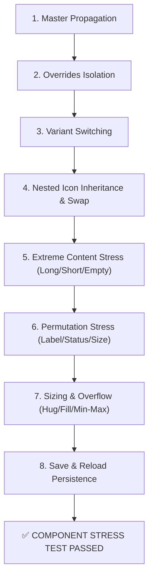

# FigCraft Native Component Engineering & Stress Testing Protocol

> **Design Orchestrator 2.1 Engineering Reference**  
> Complete technical specification for building native reusable FigCraft components, managing 3-tier design tokens, central icon libraries, atomic component hierarchies (Item $\rightarrow$ Group $\rightarrow$ Pattern), component properties, adaptive auto-layout, Figma import fidelity awareness, and executing the mandatory **8-Point Component Stress Testing Protocol**.

---

## 1. Native Component Foundations vs. Page Composition Frames

In FigCraft MCP, UI elements exist in distinct technical tiers. Agents must distinguish between **reusable interactive elements** and **page composition frames**:

| Construct | FigCraft Type | Role in Project | Creation Command | Reusability Rule |
|---|---|---|---|---|
| **Page Composition Frame** | `FRAME` with Auto-Layout | Layout shells, grid columns, body containers, sidebar wrappers | `node.create {type: "frame", props: {layout: "vertical"}}` | **Flexible Layout**. Allowed and recommended for page structure to enable responsive reflow without rigid instance overhead. |
| **Main Component (Atom/Item)** | `COMPONENT` | Master blueprint for atomic repeating UI controls (`Button`, `Input`, `Avatar`, `Nav/Item`, `List/Item`) | `component.create {ids: [frameId]}` | **Master Blueprint**. Changes to fills, radius, padding, or geometry automatically propagate to all instances. |
| **Component Set (Variants)** | `COMPONENT_SET` | State & variant matrix (e.g. Size, Style, State: Default, Hover, Focus, Active, Disabled, Error) | `component.combineVariants {ids: [...]}` | **Variant Matrix**. Shows as purple dashed border (`#9747FF`). Maintains variant properties (`instance.setProperties`). |
| **Linked Instance** | `INSTANCE` | All interactive & repeating UI elements used across screens | `instance.create {component: compId}` | **Mandatory Reusable Element**. Ad-hoc drawing of buttons or cards is strictly banned. |
| **Nested Instance** | `INSTANCE` | Composite elements (e.g. `Icon/Vector` inside `Button/Primary`) | Placed inside Main Component before combining | **Inheritance Unit**. Vector icons inherit stroke colors from parent container state. |

> [!IMPORTANT]
> **Nuanced Reusability Law**:
> - Repeating/interactive UI elements (buttons, inputs, pills, table rows, cards, nav items) **MUST** be native linked instances (`INSTANCE`).
> - Page layout wrappers and structural grid containers **MUST** be native Frames with Auto Layout (`FRAME`). Never attempt to wrap an entire page into a single rigid component.

---

## 2. Atomic Component Hierarchy: Item $\rightarrow$ Group $\rightarrow$ Pattern

To achieve enterprise-grade consistency, maintainability, and clean inheritance, components must NOT be modeled as monolithic blocks. Instead, they follow a strict 4-level atomic architecture:

```mermaid
flowchart TD
    subgraph L1 ["Level 1: Primitives & Tokens"]
        T1["Variables (3-Tier Tokens: Primitives & Semantic)"]
        T2["Text Styles (H1-H5, B1-B4, C1-C3, Button)"]
        T3["Central Vector Icon Library (Master Icons)"]
    end

    subgraph L2 ["Level 2: Atoms / Items"]
        A1["Button Variants (Sizes & States)"]
        A2["Checkbox / Radio / Toggle"]
        A3["Input Field / Avatar / Badge"]
        A4["Navbar Item / Tab Item / Breadcrumb Item"]
        A5["List Left Item / List Right Item"]
    end

    subgraph L3 ["Level 3: Molecules / Groups"]
        M1["Button Group (Group)"]
        M2["Navbar Bottom (Group) / TopBar"]
        M3["Breadcrumbs (Group)"]
        M4["List Row / Context Menu (5 Rows)"]
        M5["Dropdown Selector"]
    end

    subgraph L4 ["Level 4: Organisms / Patterns"]
        O1["Card / KPI Deck"]
        O2["Locked Column Data Table Grid"]
        O3["Pop-Up Modal Dialog"]
        O4["Action Sheet / Filter Drawer"]
        O5["Empty State & Error Containers"]
    end

    subgraph L5 ["Level 5: Screens & Viewports"]
        S1["Desktop Application Screens (1440 × 900)"]
        S2["Mobile Application Screens (390 × 844)"]
    end

    L1 --> L2
    L2 -->|instance.create| L3
    L3 -->|instance.create| L4
    L4 -->|instance.create| L5
```



### Composition Rules:
1. **Atoms / Items (`(Item)`)**:
   - Single-responsibility controls. Examples: `Navbar/Item`, `List/Left_Item`, `List/Right_Item`, `Button Group (Item)`.
   - Contain variant axes for states (`Default`, `Hover`, `Active`, `Disabled`) and content switches (`Text`, `Icon+Text`, `Icon Only`).
2. **Molecules / Groups (`(Group)`)**:
   - Assembled strictly by placing **linked instances of atoms** inside an auto-layout container.
   - Example: A 5-item `Navbar Bottom (Group)` contains 5 linked instances of `Navbar Bottom (Item)`, with one set to `State=Selected` and four set to `State=Inactive`.
   - Never duplicate raw vector paths or text layers inside groups when an atomic item exists.
3. **Organisms / Patterns**:
   - Combine molecules, atoms, and layout containers into operational modules (e.g. `Modal` assembling `Card` + `TopBar` + `Button/Primary` + `Button/Secondary`).
4. **Screens**:
   - Assemble organisms, groups, and items into responsive frames.

---

## 3. Central Vector Icon Library & Instance Swapping

Emojis (📅, 🔍, ⚙️, 👤) are strictly prohibited in professional product UI. All iconography must be maintained in a **Central Vector Icon Library**:

1. **Central Repository Structure**:
   - Located on page `01_Foundations` (or dedicated section in `02_Components`).
   - Grouped logically by functional categories (e.g. `Navigation`, `Actions`, `Status`, `Media`, `Domain`).
   - Standard bounding box: $20 \times 20\text{px}$ or $24 \times 24\text{px}$ frames with Auto Layout or fixed bounds. **Mandatory**: declare `props: { fill: "none" }` on the container frame (FigCraft defaults frame fills to `#FFFFFF`, which would create opaque white boxes inside colored buttons).
   - Vector paths drawn via `vector.create` with uniform stroke weight ($1.5\text{px}$ or $2.0\text{px}$, `strokeCap: "round"`, `strokeJoin: "round"`). **Mandatory**: declare `props: { fill: "none" }` for outline icons (FigCraft defaults vector fills to `#D9D9D9`, which would create solid filled polygons).
2. **Master Component Conversion**:
   - Each icon is converted to a native master component:
     ```json
     call_mcp_tool("figcraft", "run_command", {
       "command": "component.create",
       "params": { "id": iconFrameId, "name": "Icon/arrow-left" }
     })
     ```
3. **Nested Instance Linkage & Swapping**:
   - Interactive components (buttons, input fields, badges) embed a linked instance of an icon master:
     ```json
     call_mcp_tool("figcraft", "run_command", {
       "command": "instance.create",
       "params": { "component": iconMasterId, "parent": buttonFrameId }
     })
     ```
   - Swapping icons on instances is performed via native `instance.swap`:
     ```json
     call_mcp_tool("figcraft", "run_command", {
       "command": "instance.swap",
       "params": { "ids": [nestedIconInstanceId], "component": newIconMasterId }
     })
     ```
4. **Component Boolean Properties for Icons**:
   - To toggle icons on and off without detaching variants, add boolean properties to host components:
     ```json
     call_mcp_tool("figcraft", "run_command", {
       "command": "component.addProperty",
       "params": {
         "id": buttonComponentSetId,
         "name": "Icon Left",
         "type": "boolean",
         "layer": leftIconNodeId,
         "default": true
       }
     })
     ```

---

## 4. 3-Tier Design Tokens & FigCraft Native Variables Engine

Tokens are structured into a 3-layer architecture to enable effortless theme customization and dark mode switching:

```
+-------------------------------------------------------+
| Tier 1: Primitives                                    |
| Raw scale values: Spacing/0..6, Slate/50..900,        |
| Blue/50..900, Emerald/50..900, Crimson/50..900        |
+---------------------------+---------------------------+
                            | (Aliased by)
                            v
+-------------------------------------------------------+
| Tier 2: Semantic Tokens                               |
| Purpose-driven tokens: text-primary, surface-card,     |
| border-subtle, status-success, radius-md, spacing-lg  |
+---------------------------+---------------------------+
                            | (Assigned to)
                            v
+-------------------------------------------------------+
| Tier 3: Component Tokens                              |
| Specific element slots: button-primary-bg,            |
| table-row-hover, input-focus-ring, modal-scrim        |
+-------------------------------------------------------+
```

### FigCraft Native Execution & Fallback:
1. **Creating Collections**:
   - `variable.createCollection { name: "Primitives", modes: ["Mode 1"] }`
   - `variable.createCollection { name: "Tokens", modes: ["Light", "Dark"] }`
   - `variable.createCollection { name: "ComponentTokens", modes: ["Light", "Dark"] }`
2. **Creating Variables & Aliases**:
   - Primitive: `variable.create { collection: "Primitives", name: "Color/Brand/Primary", type: "color", value: "#047857" }`
   - Semantic Token (Alias): `variable.create { collection: "Tokens", name: "color/primary", type: "color", value: { alias: primitiveVarId } }`
   - Component Token (Alias): `variable.create { collection: "ComponentTokens", name: "btn-primary-bg", type: "color", value: { alias: semanticVarId } }`
3. **Binding to Layers**:
   - Bind variable to fill, stroke, corner radius, or padding:
     `variable.bind { ids: [nodeId], field: "cornerRadius", variable: radiusVarId }`
     `variable.bind { ids: [nodeId], field: "fill", variable: surfaceVarId }`
4. **Verified Runtime Cascade & Persistence**:
   - **Cascading Updates**: Updating a Tier 1 Primitive (e.g. `Color/Brand/Primary` `#1E40AF` $\rightarrow$ `#047857` or `Radius/md` `8.0` $\rightarrow$ `16.0`) automatically cascades through semantic aliases down to component tokens, master components, and multi-page linked instances.
   - **Save & Reload Persistence**: All collections, variables, aliases, and layer bindings (`boundVariables: { fill, cornerRadius }`) persist 100% across `figcraft/save_file` and `figcraft/open_file`.
5. **Fallback Protocol**:
   - If the runtime environment does not support native variable collections or binding fails, fall back gracefully to **FigCraft Styles** (`style.create`, `style.apply`) and enforce token values deterministically via `projects/<slug>/DESIGN.md`. Never abort design generation solely due to variable persistence limitations.

---

## 5. Adaptive Modular Artboard Architecture

Rather than forcing components into a rigid 5-artboard layout or cramming everything into one artboard, component artboards are organized **by component family according to product complexity**:

### Artboard Organization Matrix:
- **`Foundations` (Page 01)**:
  - `Typography_Specimen`: Complete font scale specimens (`H1`–`H5`, `S1`–`S2`, `B1`–`B4`, `C1`–`C3`, Button scale) with px sizes, line heights, and sample strings.
  - `Palette_Specimen`: Color swatches displaying hex codes, semantic roles, contrast ratios, and token names.
  - `Shadow_Specimen`: Dual-elevation cards demonstrating ambient blur + key shadow pairs.
  - `Central_Icon_Hub`: Categorized grid of all master vector icons.
- **`Components` (Page 02)**:
  - `Actions_Buttons`: Primary, Secondary, Outline, Ghost, Danger, Icon-only buttons.
  - `Selection_Controls`: Checkboxes, Radios, Toggles, Steppers with text-side variants.
  - `Form_Inputs`: Text fields, Search boxes, Textareas, Dropdown selects in all states (`Default`, `Hover`, `Focus`, `Disabled`, `Error`).
  - `Navigation_Elements`: Topbars, Bottom navbars, Tabs, Breadcrumbs, Pagination.
  - `Feedback_Indicators`: Status badges, Alert banners, Tooltips, Progress bars, Loaders.
  - `Overlays_Menus`: Pop-Up modals, Action sheets, Context menus, Dropdown menus.
  - `Data_Display`: Metric KPI cards, Avatar clusters, List row components.
- **`Patterns` (Page 03)**:
  - `Data_Tables`: Locked-column header and row combinations, batch action bars, pagination footers.
  - `Composite_Forms`: Multi-section form cards, filter bars, search headers.
  - `Instances_Showcase`: 100% native linked instances composited preview verifying cross-component interoperability.

### Spatial Clearance Standard:
- **Title Header Cards**: Every artboard must have a header card placed directly above it matching the artboard width, specifying Component Name, Category, and Specs.
- **Variant Label Clearance**: Labels describing variants must maintain $\ge 24\text{px}$ clearance outside purple `COMPONENT_SET` bounding boxes to prevent visual collision.
- **Inter-Group Spacing**: Components within an artboard must maintain $\ge 40\text{px}$ to $48\text{px}$ vertical gap.
- **Artboard Gutter**: Horizontal gap between artboards = $60\text{px}$ to $80\text{px}$; vertical gap = $60\text{px}$ to $80\text{px}$.

---

## 6. The Mandatory 8-Point Component Stress Testing Protocol

A component is **never declared production-ready** simply because it has `type: "COMPONENT"` or `type: "INSTANCE"`. Every critical component must be stress-tested against 8 real-world conditions on canvas:



### Test 1: Master-to-Instance Propagation
- **Action**: Select Master Component (e.g. `Card/KPI` `nodeId`), temporarily modify `cornerRadius` or background fill via `node.set`.
- **Verification**: Inspect linked instance via `get_node`. Confirm that the instance automatically inherits the updated property.
- **Reversion**: Revert Master Component back to standard token design.

### Test 2: Text & Property Overrides Isolation
- **Action**: Modify `characters` on a text node inside an instance, or change a boolean/text property via `instance.setProperties`.
- **Verification**: Inspect the Master Component and peer instances; verify that they remain completely unaffected by the override.

### Test 3: Variant Switching
- **Action**: Execute `instance.setProperties {id: instId, properties: {"State": "Hover"}}` or switch between Status variants (`Success` $\rightarrow$ `Critical`).
- **Verification**: Confirm via `get_node` and screenshot that visual appearance switches cleanly without detaching or throwing errors.

### Test 4: Nested Component Linkage & Icon Color Inheritance
- **Action**: Modify child Master Component (e.g. nested vector icon stroke) or execute `instance.swap`.
- **Verification**: Confirm that the change cascades through the composite master into all composite instances. Confirm icon stroke correctly matches container state (white on dark primary button, muted on disabled).

### Test 5: Extreme Content Stress (Long, Short, Empty)
- **Action**: Inject 3 boundary text values into linked instances:
  * *Extreme Long*: `"Persetujuan Izin Menikah dan Cuti Tahunan Bersama Wilayah Operasional Kalimantan Timur"`
  * *Extreme Short*: `"OK"` or `"1"`
  * *Empty/Zero*: `""` or `0`
- **Verification**: Confirm that containers do not overflow, buttons do not collapse awkwardly, table rows maintain height bounds, and typography remains fully readable.

### Test 6: Permutation Stress (Status, Units, Values)
- **Action**: On metric cards and table rows, swap units (`Kg`, `Ton`, `Rp`, `%`, `Orang`) and delta states (positive `+12.4%`, negative `-3.2%`, neutral `0.0%`).
- **Verification**: Confirm that badge colors, delta indicators, and tabular numbers align without line wrapping or text collision.

### Test 7: Sizing Constraints & Overflow Stress
- **Action**: Place instances inside containers with varying widths (e.g. 220px sidebar vs 800px main content).
- **Verified Runtime Sizing & Text Overflow Policy**:
  * *Zero Critical Data Loss Law*: Text overflow handling must **NEVER** hide, truncate, or obscure critical operational data (such as monetary figures, KPI metrics, legal/approval status, employee identities, dates, or system error alerts).
  * *Multi-line Wrapping as Default*: For headings, card titles, table cells with critical info, descriptions, and notification alerts, use wrapping (`textAutoResize: "height"`, parent frame `wrap: true` or vertical auto-layout) so the container expands vertically rather than clipping crucial data.
  * *Adaptive Sizing*: Utilize `sizingH: "hug"` or flexible layout when container space allows dynamic horizontal expansion.
  * *Secondary Detail Clues*: When narrow spatial constraints demand a compact badge or truncated control, always provide complete unabbreviated data via detail drawers, modals, or secondary expansion affordances.
  * *Native Ellipsis Truncation*: Setting `textAutoResize: "truncate"` with a constrained width (or `sizingH: "fill"`) triggers native `...` ellipsis cleanly. This is strictly permitted ONLY on secondary/auxiliary strings (e.g. lengthy URL paths, secondary email handles in compact tables, supplementary log remarks) where truncation does not compromise operational decisions.
  * *Sidebar & Full-Width Buttons*: Set `sizingH: "fill"` on the instance so it smoothly stretches across the full interior width of the parent frame while preserving horizontal padding.
  * *Boolean Icon Toggles*: When `hasIcon: false` is set on a button, the icon layer becomes `visible: false` and auto-layout re-centers the remaining text automatically.
- **Verification**: Verify that auto-layout children respect `sizingH: "fill"` or `sizingH: "hug"`, padding is preserved, and minimum touch target ($\ge 44\text{px}$ mobile, $\ge 32\text{px}$ desktop) is satisfied.

### Test 8: Save & Reload Persistence
- **Action**: Save file via `figcraft/save_file(path: "...")`, reopen via `figcraft/open_file(path: "...")`.
- **Verification**: Run `call_mcp_tool("figcraft", "run_command", {"command": "component.list", "params": {}})`. Confirm that 100% of Master Components, Component Sets, and linked instances remain preserved and connected.

---

## 7. Figma Import Fidelity Awareness & Native Feature Fallbacks

External Figma templates and UI Kits are rich architectural benchmarks, but imported `.fig` or clipboard data can present rendering discrepancies. Agents must follow these rules of awareness:

| Feature / Aspect | Import Behavior in FigCraft | Potential Risk / Artifact | Mandatory Agent Protocol & Fallback |
|---|---|---|---|
| **Auto Layout** | Converted to `layout: { mode, gap, padding, mainAlign, crossAlign }`. | High fidelity, but check wrapped or grid tracks. | Verify `layout.mode` and padding via `get_node`. Set explicitly if missing. |
| **Variables & Collections** | Flat serialization with IDs like `399:2862`. Root `type` may read `None`. | Aliases work, but mode switching UI may be simplified. | Check `variable.list`. Bind via `variable.bind`. Fallback to `styles` and `DESIGN.md` if binding fails. |
| **Component Properties** | Boolean properties import cleanly; complex variant maps may be flattened to variant names. | Property controls in inspector may not show all text/swap slots. | Use variant string naming (`Property=Value`) as the primary variant selector. Use `component.addProperty` for explicit booleans. |
| **Styles vs Raw Paints** | `style.list` returns metadata, but `value` may serialize as `None`. | Style values may detach if node properties are overwritten without style ID. | Apply styles via `style.apply {style: styleId}` or maintain raw token paints mapped in `DESIGN.md`. |
| **Visual Rendering Discrepancies** | Gradients, complex blend modes, or variable font weights may render differently from Figma desktop. | Visual appearance does not match native Figma canvas 100%. | **Never assume visual correctness from node tree alone.** Always inspect unselected exported screenshots via multimodal VQA 2.0 before approval. |

---

## 8. Non-Destructive Testing with `component.playground`

When available in FigCraft MCP, agents should leverage `component.playground` to preview property configurations and verify code generation without mutating canvas state:

```json
call_mcp_tool("figcraft", "run_command", {
  "command": "component.playground",
  "params": {
    "id": "button_set_id",
    "properties": {
      "State": "Hover",
      "Type": "Primary"
    },
    "language": "react"
  }
})
```
*Returns property schema, preview dimensions, and verified React/CSS code snippet.*

---

## 9. Technical Verification (Tier 1) vs Visual Craft Quality (Tier 2)

A fundamental principle of the Design Orchestrator is the **separation of mechanical/technical validity from aesthetic excellence**:

```
+---------------------------------------------------------------------------------+
| TIER 1: Technical Integrity Verification (Deterministic & Mechanically Measurable) |
| - Native component types (COMPONENT, COMPONENT_SET, INSTANCE)                   |
| - 3-tier variable binding resolution and alias integrity                        |
| - Layout mode: auto-layout explicit (horizontal/vertical, padding, gaps)       |
| - Alignment metrics: locked table column delta |Δx| <= 1px                      |
| - Persistence across save/reload operations                                     |
| -> STATUS: TECHNICAL_RUNTIME_PASS (Objective Binary Check Passed)               |
+---------------------------------------------------------------------------------+
                                       |
                                       v
+---------------------------------------------------------------------------------+
| TIER 2: Visual & Craft Quality Evaluation (Multimodal & Perceptual)             |
| - WCAG 2.2 contrast compliance (AA >= 4.5:1 text, >= 3.0:1 controls)             |
| - Color harmony and zero conflicting saturated hues                              |
| - Typography scale rhythm, font pairings, and line-height balance                |
| - Whitespace distribution and visual breathing room                             |
| - Information hierarchy and cognitive density (avoiding clutter or emptiness)    |
| - Character, personality, and anti-slop domain authenticity                      |
| -> STATUS: PENDING USER APPROVAL / READY_FOR_CONTROLLED_PILOT                   |
+---------------------------------------------------------------------------------+
```

> [!IMPORTANT]
> **System Readiness Verdict**: `TECHNICAL_RUNTIME_PASS / READY_FOR_CONTROLLED_PILOT`  
> Technical runtime mechanics are 100% verified on FigCraft MCP. However, premium visual craft quality is NEVER claimed prematurely on the basis of component mechanics alone; it requires end-to-end evaluation in controlled pilot projects with human sign-off at the Approval Gates.

> [!CAUTION]
> **Zero False Proclamation Law**:
> Never declare a design "premium", "production-ready", or "flawless" purely on the basis that component mechanics, variables, or layout commands succeeded (Tier 1 PASS). Technical correctness is a necessary baseline, not proof of aesthetic craft. Full visual quality (Tier 2) must be visually inspected via exported unselected screenshots and signed off by the user at the Approval Gates.


---

## 10. Verified FigCraft Execution Engine & Recipes (Sprint 3)

In Design Orchestrator 2.2, native component creation is automated through verified command recipes executing over FigCraft MCP via Stdio JSON-RPC (`scripts/figcraft_engine.py` and `scripts/build-native-design-system.ps1`).

### Tool & Command Dispatch Protocol
FigCraft exposes commands through the MCP `run_command` tool rather than distinct tool endpoints for each primitive:
- **Direct MCP Tools**: `create_node`, `set_properties`, `inspect_document`, `get_node`, `select`, `export`, `screenshot`, `open_file`, `save_file`, `batch`.
- **Command Dispatch via `run_command`**:
  - `variable.createCollection`, `variable.create`, `variable.bind`, `variable.list`
  - `component.create`, `component.combineVariants`, `component.addProperty`, `component.list`
  - `instance.create`, `instance.setProperties`, `instance.swap`
  - `node.find`, `node.delete`, `node.duplicate`

### The 7 Native Execution Recipes:

1. **Recipe 1: 3-Tier Token Generation & Alias Chains**:
   - `Primitives` collection: Raw values (`Slate/900`, `Blue/600`, `Radius/md`).
   - `SemanticTokens` collection: Semantically named aliases (`surfaceBase`, `primary`, `textPrimary`) referencing Primitive variable IDs via `{ "alias": "<id>" }`.
   - `ComponentTokens` collection: Component-level tokens (`btn-primary-bg`, `btn-primary-text`) referencing Semantic variable IDs.

2. **Recipe 2: Central Vector Icon Library**:
   - Icon frames created inside `01_Foundations/Central_Icon_Library` with `layout: "none"` or fixed $20 \times 20$ / $24 \times 24$ geometry and `props: { fill: "none" }`.
   - Vector paths drawn via `create_node { type: "vector", path: "M..." }` with `fill: "none"` and explicit `stroke`.
   - Converted to master component via `component.create`.

3. **Recipe 3: Atomic Master Components**:
   - Master frames created with auto-layout (`layout: "horizontal"` or `"vertical"`), explicit padding, gap, and fills.
   - Child text layers created with typography specs and contrasting colors ($\ge 4.5:1$).
   - Master registered via `component.create`.

4. **Recipe 4: Component Variant Sets**:
   - Two or more related master components created (e.g. `Button/Default`, `Button/Hover`).
   - Combined into a unified `COMPONENT_SET` via `component.combineVariants { ids: [id1, id2] }`.
   - Instances switch states seamlessly via `instance.setProperties { ids: [instId], properties: { "State": "Hover" } }`.

5. **Recipe 5: Linked Instances & Override Isolation**:
   - Instances instantiated via `instance.create { component: compId, parent: parentFrameId }`.
   - Text overrides applied directly to the instance's text child nodes without modifying the master component or sibling instances.

6. **Recipe 6: Dynamic Auto Layout & Sizing Constraints**:
   - Layout containers declare `sizingH: "hug"` or `sizingH: "fill"`.
   - Text expansion dynamically stretches container frames without boundary clipping or text collision.

7. **Recipe 7: Composite Reusable UI Patterns**:
   - Patterns (e.g. Telemetry Metric Card, Table Row, Modal Dialog) assembled by embedding linked instances of Badge, Button, and vector icons into a parent Frame.
   - Master structural elements remain modular; layout wrappers remain `FRAME`.
