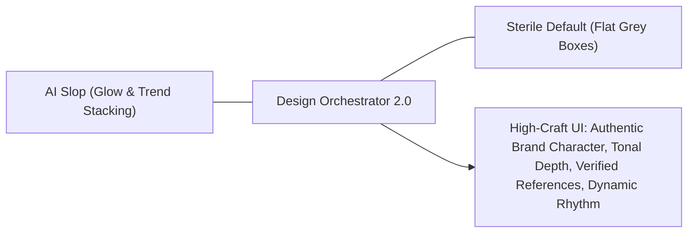

# Creative Direction & Visual Reference Intelligence

> **Design Orchestrator 2.0 Reference**  
> Guidelines for conducting deep visual reference research, escaping generic AI templates, formulating differentiated visual concepts, and establishing mature creative direction before building design systems.

---

## 1. Escaping Generic AI Slop & The "Sterile Default" Trap

AI coding agents typically fail visual design in one of two extremes:
1. **The AI Slop Extreme**: Purple-to-blue mesh gradients, glowing cards everywhere, unanchored floating boxes, generic capsule badges, skeleton loaders masquerading as UI, and Lucide icons without domain context.
2. **The Sterile Default Extreme**: Flat white/grey boxes, heavy dark borders on every element (`1px solid #334155`), lack of surface depth, tiny 10px monospace text, and zero brand personality.

**The Solution**: Creative Direction with **Intentional Depth, Distinct Typography, Purposeful Color Harmony, and Visual Rhythm**.

---

## 2. Visual Reference Research Protocol

Before writing tokens or creating frames, the agent must curate **3 to 5 real-world design benchmarks**.

### 2.1 Research Channels & Verification
- **Mobbin MCP (`search_screens`, `search_flows`)**: Search production web and mobile apps solving similar operational, financial, enterprise, or consumer workflows.
- **browser-use CLI**: Search curated galleries (Behance, Dribbble, Siteinspire, Godly, Mobbin Web) for contemporary typography, layout compositions, and interaction micro-patterns.
- **UI/UX Pro Max (`search.py`)**: Query in-memory design intelligence for curated font pairings, color palettes, and surface modes.
- **Verification Rule**: **Never invent or hallucinate URLs.** If an online query was not executed, cite the exact source tool (e.g. `UI/UX Pro Max In-Memory Matrix [Operate / Precision]`).
- **Confidentiality Hard Rule**: **NEVER** transmit confidential PRD text, client company names, internal schemas, or PII into external search queries. Always generalize to abstract domain workflows (e.g. use *"enterprise logistics dispatch grid"* instead of *"Internal Enterprise ERP"*).

### 2.2 Deep Architectural Analysis Checklist
For each curated reference, analyze:
1. **Typography**: Font family classification (geometric sans, humanist, neo-grotesque, editorial serif, tabular mono), weights, line height, and tracking.
2. **Surface & Depth Model**: Tonal layering (canvas `#F8FAFC` $\rightarrow$ surface `#FFFFFF` $\rightarrow$ raised `#FFFFFF + shadow`), border weight/color, or subtle gradient anchors.
3. **Information Density**: Compact ($36\text{px}-40\text{px}$ row height), Comfortable ($44\text{px}-52\text{px}$), or Spacious ($56\text{px}-64\text{px}$).
4. **Focal Points & Asymmetry**: How the layout draws the eye to primary CTAs and key metrics without clutter.
5. **Iconography & Visual Identity**: Vector stroke weight, filled vs duotone vs outline, corner styling.

---

## 3. Formulating 2 to 3 Differentiated Concepts

Visual concepts must represent **genuinely distinct creative directions**, not merely slight hue shifts of the same layout.

### Concept Diversity Dimensions:

| Dimension | Option A: Precision / High-Density | Option B: Contemporary Editorial | Option C: Tactile Command / Dark Slate |
|---|---|---|---|
| **Visual Mood** | Utilitarian, crisp, structured, maximum data density. | Warm, inviting, spacious, narrative-driven. | Ultra-focused, technical, high-contrast, immersive. |
| **Canvas & Surface** | Cool slate canvas (`#F8FAFC`), crisp white cards, 1px structural borders (`#E2E8F0`). | Warm ivory canvas (`#FAF9F5`), soft paper cards, warm border (`#E7E5E0`). | Obsidian/slate backdrop (`#0B0F17`), dark cards (`#151D2A`), subtle border (`#243042`). |
| **Typography Pairing** | `Plus Jakarta Sans` or `Inter` + `JetBrains Mono` for tabular data. | `Newsreader` or `Instrument Serif` (Headings) + `Inter` / `Geist` (Body). | `Geist Sans` + `Geist Mono` (Ultra-sharp tech sans). |
| **Elevation & Depth** | Border-first with micro-shadows (`0 1px 2px rgba(0,0,0,0.05)`). | Diffused ambient shadows (`0 8px 24px rgba(0,0,0,0.04)`), soft edges. | Pure border definition (`1px solid #243042`), zero ambient glow, sharp contrast. |
| **Density & Padding** | Base 8px, table row 44px, compact table padding 12–16px. | Base 8px, table row 52px, spacious padding 24–32px. | Base 4px/8px, table row 40px, dense scanability. |

### Presentation Protocol:
1. Present the concept matrix in chat with clear trade-offs.
2. Highlight **1 primary recommendation** based on product persona, surface mode, and workflow volume.
3. Explicitly allow the user to blend features (e.g. *"Use Concept 1 colors with Concept 2 typography"*).
4. **🛑 CONCEPT APPROVAL GATE**: Wait for user sign-off before creating design system tokens or frames.

