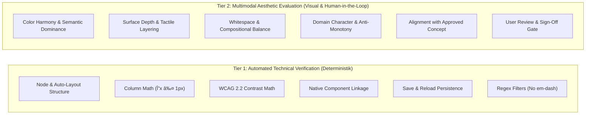
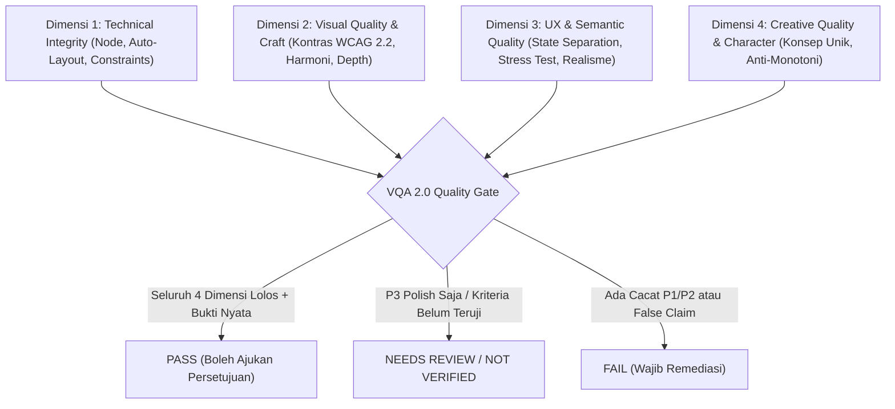

# Visual Quality Assurance (VQA) 2.0 Engine: The 4-Dimensional Verification System

> **Design Orchestrator 2.0 Verification Engine**  
> The Visual Quality Assurance (VQA) 2.0 Engine evaluates FigCraft designs across **four distinct, non-overlapping dimensions**. It eliminates subjective claims and false "PASS" verdicts by coupling strict mathematical geometry checks with multimodal visual artifact audits, WCAG 2.2 contrast validation, and real-world stress testing.

---

## 1. The Core Law of Verification: No False PASS

> [!CRITICAL]
> **Zero Tolerance for Premature or False Success**:
> 1. Taking a screenshot or executing FigCraft commands is **NOT** proof of correct design.
> 2. Bounding box math ($\Delta x = 0$) alone is **NOT** proof of visual harmony.
> 3. An agent must **never report `0 P1/P2` or declare `PASS`** if visible defects remain in unselected exported screenshots (color clashes, unreadable text, overlapping labels, border collisions, or dead whitespace).
> 4. **Zero Macro Glancing Rule**: Never evaluate an artboard solely from a macro full-canvas zoom. High-density areas (action clusters, table action columns, drawer overlays, nested badges) must be inspected at local resolution to detect edge collisions, sub-pixel clipping, and rogue bounding-box strokes.
> 5. If an automated check was not possible, it must be reported honestly as `NOT VERIFIED`. Never disguise unverified criteria as passed.
> 6. Aesthetic and creative ratings must include concrete visual comparisons and rationale—never claim "premium quality" simply because a checklist was filled.

---

## 1.1 Separation of Automated Technical Verification vs. Human Aesthetic Evaluation

The verification engine strictly separates **deterministic technical tests** from **evaluative aesthetic judgements**:



- **Tier 1 (Automated Technical Verification)**: Can be verified programmatically or via exact tool outputs. Yields binary pass/fail data.
- **Tier 2 (Multimodal Aesthetic Evaluation)**: Evaluated through unselected rendered screenshot inspection (`file.exportLayers`) and human visual perception. **Cannot be declared PASS by a script alone**; requires explicit user sign-off at the Approval Gates.

---

## 1.2 Impact-Based Defect Classification

Defects are classified strictly by their **actual user and operational impact**, preventing overly rigid aesthetic tastes from blocking progress:

| Priority | Impact Level | Criteria & Examples | Permitted Action |
|---|---|---|---|
| **P1 (Critical / Blocker)** | **Functional, Severe Accessibility, or Architectural Failure** | - Broken navigation or dead interactive controls without destination.<br>- Contrast ratio $< 3.0:1$ on text, or typography below floor ($< 11\text{px}$).<br>- Touch target $< 44\text{px}$ on mobile viewports.<br>- Data truncation that hides essential decision metrics.<br>- Plain frames falsely claiming to be reusable components.<br>- Component breaking or collapsing under dynamic content stress. | **BLOCK DELIVERY**. Must remediate before advancing. |
| **P2 (Major Impact)** | **Noticeable Usability, Semantic, or Visual Degradation** | - Table column misalignment $\Delta x > 2\text{px}$.<br>- Contrast between $3.0:1$ and $4.5:1$ on normal text (WCAG AA violation).<br>- Severe color clashing that disrupts semantic clarity (e.g. status cyan on primary green button).<br>- Overlapping labels with component borders ($< 24\text{px}$ clearance).<br>- State collision (empty state mixed into populated table).<br>- Dead unanchored whitespace $> 100\text{px}$. | Must be remediated in the current pass or flagged for immediate review. |
| **P3 (Minor / Polish)** | **Aesthetic Nuance & Fine Refinement** | - Subtle optical alignment ($\Delta x \le 1\text{px}$).<br>- Spacing rhythm refinement (e.g. 12px vs 16px).<br>- Subtle border or shadow tone adjustments.<br>- Stylistic preferences that do NOT impair legibility, comprehension, or usability.<br>*(Aesthetic nuances must NEVER be classified as P1 or block delivery).* | Recorded for polish; does not block gate advancement. |

---

## 2. The 4 Verification Dimensions



---

### Dimensi 1: Technical Integrity (Geometri, Auto-Layout & Komponen)

- **Explicit Auto-Layout**: Parent frames must declare explicit `layout` mode (`vertical` or `horizontal`). Absolute positioning is strictly prohibited except for intentional layered badge overlays or decorative background patterns.
- **Sizing Sanity**:
  - `sizingH: "fill"` is valid only inside an auto-layout parent with known constraints.
  - Sizing must match intent: fixed width for locked grid columns, `hug` for badges and button labels, `fill` for responsive content panels.
- **Table Column Alignment Math**:
  - In tabular views, each column $C_i$ in row $R_j$ must share the exact starting horizontal coordinate $x$ and width $w$ with the corresponding header column $C_{i,\text{header}}$:
    $$\Delta x = |x(C_{i, R_j}) - x(C_{i, \text{header}})| \le 1\text{px}$$
    $$\Delta w = |w(C_{i, R_j}) - w(C_{i, \text{header}})| \le 1\text{px}$$
  - An offset $>2\text{px}$ is a **P1 Alignment Failure**.
- **Container Boundary & Right Edge Clearance**:
  - Children inside any container (cards, modals, table rows) must satisfy $x_{\text{rel}} + w \le W_{\text{container}} - \text{padding}_{\text{right}}$.
  - Action buttons in table rows must preserve $\ge 32\text{px}$ clearance from the right row boundary. Any overflow or edge collision is a **P1 Clipping Defect**.
  - Reusable instances placed in constrained containers (e.g. AlertBanner in a drawer) must adapt to container width, with nested text configured with `textAutoResize: "height"` to wrap cleanly over multiple lines rather than clipping.
- **Row Height Bloat**:
  - Table rows must avoid bloated empty space caused by inner containers with unintentional fixed height.
  - Standard row height: $40\text{px} \le h_{\text{row}} \le 56\text{px}$ for enterprise data tables.
- **Native Component Verification**:
  - Verify that every reusable component is a true native FigCraft `COMPONENT` or `COMPONENT_SET`, NOT a plain frame.
  - Linked instances must carry valid `mainComponentId` references.
- **Save & Reload Persistence**:
  - Saved files must retain 100% component and instance linkages upon reopening (`component.list`).

---

### Dimensi 2: Visual Quality & Craftsmanship (Estetika, Harmoni & Kontras)

- **WCAG 2.2 Contrast & Target Standards (Official W3C)**:
  - **Normal Text (SC 1.4.3 AA)**: Body and labels ($< 24\text{px}$ regular, or $< 18.5\text{px}$ bold) require a minimum contrast ratio $\ge 4.5:1$ against surface background.
  - **Large Text (SC 1.4.3 AA)**: Display and titles ($\ge 24\text{px}$ regular, or $\ge 18.5\text{px}$ bold) require a minimum contrast ratio $\ge 3.0:1$.
  - **Non-Text UI Components & Graphical Objects (SC 1.4.11 AA)**: Interactive control borders, active icons, focus rings, and state indicators require a minimum contrast ratio $\ge 3.0:1$ against adjacent background colors.
  - **Enhanced Contrast (SC 1.4.6 AAA - Optional High-Accessibility)**: $\ge 7.0:1$ for normal text, $\ge 4.5:1$ for large text.
  - **Target Size (SC 2.5.8 AA & Apple HIG / Material 3)**: Interactive targets must satisfy $\ge 24 \times 24\text{px}$ spacing (WCAG 2.2 AA) with standard primary mobile tap targets $\ge 44 \times 44\text{px}$.
  - Contrast must be calculated accurately across the entire area the text or stroke spans, not at a single arbitrary pixel.
- **Color Harmony & Brand Dominance**:
  - Primary CTA buttons (`Button/Primary`) must dominate the canvas with the primary brand tone.
  - Secondary or status colors (such as cyan, amber, or purple) are **strictly forbidden** from being placed as icons or accents directly on top of primary button backgrounds.
  - Avoid "status color flood": status fills must be subtle tints, never blinding full-saturation backgrounds across the whole card.
- **Tactile Depth & Proportional Borders**:
  - Reject sterile, flat, monotonous grey-on-grey boxes WITHOUT falling into heavy, thick border traps.
  - Do NOT make every border aggressively dark (`#334155`). Use soft structural boundaries (`#E2E8F0` or `#E5E7EB`) layered with subtle micro-elevation (`0 1px 2px rgba(0,0,0,0.05)` and hover lift `0 4px 6px -1px rgba(0,0,0,0.08)`).
- **Typography Scale & Legibility Floor**:
  - Minimum body text: $13\text{px}-14\text{px}$.
  - Minimum micro/caption text: $11\text{px}-12\text{px}$.
  - **Never shrink typography to unreadable sizes ($<11\text{px}$) merely to squeeze content into a table.**
  - Single-line button and badge text must be vertically centered in their containers ($y_{\text{center}} \pm 1\text{px}$).
- **Clean Screenshot Evaluation**:
  - Screenshots used for audit must be taken with `ids: [frame_id]` and NO active selection borders, blue handles, or editor chrome.
- **Nested Vector Stroke & State Consistency**:
  - Nested vector icons inside component sets must maintain identical stroke weight and fill rules across all interactive states (Default, Hover, Active, Disabled).
  - Unwanted bounding-box frame strokes or dark strokes on dark/brand fills (creating a rogue box or border around an icon in one state) are classified as **P2 Visual Defects**.
- **Whitespace Intentionality vs. Accidental Dead Space**:
  - Generous negative space is an authentic, elegant design tool (especially in editorial, minimalist, or luxury products) and must NOT be penalised as empty space.
  - Cacat hanya berlaku pada **dead unanchored whitespace** yang terjadi akibat kesalahan konfigurasi kontainer (misal: parent frame berketinggian fixed sehingga menyisakan ruang kosong bolong tak terjangkau di bagian bawah).
  - Variant labels must maintain $\ge 24\text{px}$ clearance outside purple component bounding boxes.

---

### Dimensi 3: UX & Semantic Quality (Interaksi, Data & State)

- **Strict State Separation**:
  - Populated, empty, loading, and error states must NEVER be collaged together into the same viewport.
  - Empty states must be delivered as separate dedicated frames or variant views.
- **Action Affordances**:
  - Buttons, tabs, and toggles must look undeniably interactive (visible background, border, or elevation).
- **Domain Realism & Data Integrity**:
  - All metrics, KPIs, and labels must be logical and reflect real domain physics (e.g. real units `Kg`, `Orang`, valid dates, realistic deltas).
  - Fake marketing fluff (e.g. "99.9% AI accuracy") is strictly prohibited. All placeholder data must be tagged `[SIMULASI]`.
  - **Cross-Column Semantic Consistency**: Status badges, corridor indicators, and deviation tags must strictly agree with adjacent quantitative data (e.g. temperature reading vs corridor status). Mismatched semantic indicators are **P2 Semantic Defects**.
  - **Truth in Documentation**: Specimen board title cards, subtitles, and state listings must strictly match the actual canvas implementation, with zero phantom components or non-existent states claimed.
- **Stress-Testing Passed**:
  - Components must be verified against the 8-Point Stress Test: extreme long labels, short text, unit variations, and dynamic overflow.

---

### Dimensi 4: Creative Quality & Product Character (Inovasi & Anti-Monotoni)

- **Anti-Monotony Bar**:
  - If the logo and product name were swapped out, would the interface still have its own distinct personality and character? If NO, the design is too generic.
  - Does the design fit the specific product domain (e.g. enterprise operational command, fintech precision, or editorial clarity) instead of looking like a generic SaaS template?
- **Alignment with Approved Visual Concept**:
  - Does the canvas faithfully realize the typography pairings, surface depth model, and density approved during Stage 4?
- **Purposeful Innovation**:
  - Any creative technique (asymmetry, tinted glass accent, dark mode cockpit, editorial typography) must fulfill a clear visual or cognitive purpose, documented in `DESIGN.md`.

---

## 3. Objective Quality Gate Classification

| Verdict | Required Conditions | Permitted Next Action |
|---|---|---|
| **PASS** | - All 4 dimensions pass 100%.<br>- 0 open P1 (Critical) defects.<br>- 0 open P2 (Major) defects.<br>- 8-Point Stress Testing verified.<br>- Supported by clean unselected screenshots and bounding box math. | Advance to User Approval Gate (`PENDING_USER_APPROVAL`). |
| **NEEDS REVIEW** | - All P1 issues resolved, but minor P3 cosmetic nuances remain.<br>- OR certain criteria require human aesthetic judgment (flagged explicitly with visual comparisons). | Submit findings with clear questions for user decision. |
| **NOT VERIFIED** | - Criteria could not be tested by available tools (e.g. live responsive touch testing on physical device). | Declare honestly as NOT VERIFIED. Never mark as PASS. |
| **FAIL** | - Any P1 defect remains open (color clash, overlapping labels, broken alignment $>2\text{px}$, touch target $<44\text{px}$, em-dash in copy, fake claims).<br>- Fake components detected (plain frames labeled as components).<br>- Component breaks under extreme content stress testing. | **BLOCK ADVANCEMENT**. Execute mandatory remediation pass. |

---

## 4. Standard Finding Record Schema

Every defect discovered during VQA must be recorded in this format:

```markdown
### Finding [F-XX]: [Concise Title]
- **Dimension**: [1. Technical Integrity | 2. Visual Quality | 3. UX & Semantic | 4. Creative Quality]
- **Priority**: [P1 (Critical) | P2 (Major) | P3 (Minor)]
- **Node ID**: [Node ID, Component Name, or Artboard ID]
- **Concrete Evidence**: [Bounding box bounds `x, y, w, h`, coordinate delta $\Delta x$, hex color clashing, or screenshot reference]
- **Expected Condition**: [The mathematical rule, contrast threshold, or design system standard]
- **Remediation Action**: [Exact FigCraft MCP command or property modification required]
- **Verification Result**: [Post-fix bounding box, re-screenshot verification, or NOT VERIFIED]
```

