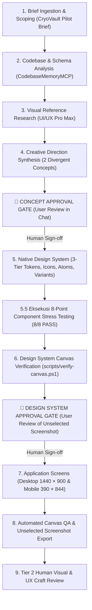

# End-to-End Pilot Execution Protocol (v2.2 Post-Sprint 4)

> **Document Purpose**: Complete operational standard operating procedure (SOP) for running the controlled end-to-end pilot validation of Design Orchestrator 2.2 using the synthetic benchmark brief (`tests/fixtures/pilot/synthetic-pilot-brief.json`).

---

## 1. Governance & Strict Anti-Auto-Approval Rules

A core vulnerability of autonomous AI workflows is self-approval loops ("hallucinated sign-offs"). For the v2.2 End-to-End Pilot, the following rules are strictly enforced:

1. **🛑 CONCEPT APPROVAL GATE (Stage 4)**:
   - The agent presents 2 divergent concepts with contrast ratios, typography pairings, and layout models in chat.
   - **Hard Stop**: The agent must yield execution to the human user.
   - Auto-approving the concept on behalf of the user is strictly prohibited in production and pilot runs.
2. **🛑 DESIGN SYSTEM APPROVAL GATE (Stage 6)**:
   - The agent presents the unselected screenshot of the component specimen sheet (`native-design-system-test.png`) and the 8-Point Stress Test report.
   - **Hard Stop**: The agent must yield execution until explicit user approval is granted in chat.
3. **Deterministic QA (Tier 1) vs Visual Craft (Tier 2)**:
   - A `PASS` from `scripts/verify-canvas.ps1` certifies only mathematical and structural properties ($|\Delta x| \le 1\text{px}$, container bounds, WCAG math).
   - Premium craft quality, visual balance, and personality are evaluated separately via Human Visual Review.

---

## 2. Stage-by-Stage Pilot Workflow

### Stage 1: Discovery & PRD Ingestion
- Read `tests/fixtures/pilot/synthetic-pilot-brief.json` in read-only mode.
- Initialize `projects/cryovault-coldchain/REQUIREMENTS_MAP.md`.

### Stage 2: Codebase & Schema Verification
- Check status enums and data models via CodebaseMemoryMCP.

### Stage 3: Visual Reference Research
- Query UI/UX Pro Max for medical/telemetry palettes and humanist sans pairings:
  `python .agents/skills/ui-ux-pro-max/scripts/search.py "biomedical telemetry cold-chain" --design-system --json`

### Stage 4: Creative Direction & Concept Gate
- Generate 2 structurally divergent concepts across 10 mandatory dimensions.
- Verify WCAG contrast via `scripts/evaluate-creative-direction.ps1`.
- **STOP for User Sign-off.**

### Stage 5: Native Design System Construction
- Execute `scripts/build-native-design-system.ps1` with CryoVault tokens.
- Execute 8-Point Stress Test: Propagation, Overrides, Variants, Icons, Content Stress, Permutations, Sizing, Save/Reload.

### Stage 6: Design System Approval Gate
- Export unselected screenshot.
- Verify canvas geometry via `scripts/verify-canvas.ps1`.
- **STOP for User Sign-off.**

### Stage 7: Application Screen Execution
- Assemble Desktop (1440x900) and Mobile (390x844) screens.
- Use 100% linked instances (`INSTANCE`) for interactive controls.
- Enforce locked columns ($|\Delta x| \le 1\text{px}$) on shipment inventory table.

### Stage 8: Automated Canvas QA & Tier 2 Review
- Execute `scripts/verify-canvas.ps1` (require P1: 0, P2: 0, Incomplete: 0).
- Deliver unselected screenshot artifacts for Tier 2 Visual Review.
