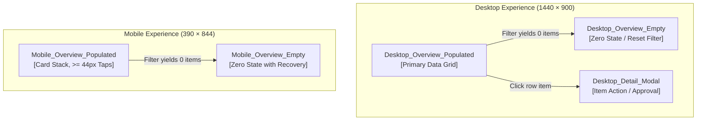

# Screen Catalog & Viewport Inventory: [Project Name]

> **Project Identifier**: `[project-slug]`  
> **Primary Design File**: `projects/[project-slug]/[project-slug].figcraft`  
> **Last Updated**: [YYYY-MM-DD]

---

## 1. Document Architecture & Canvas Organization

The primary document `projects/[project-slug]/[project-slug].figcraft` is partitioned into three logical sections (pages or canvas sections):

| Section Name | Type | Contents | Status |
|---|---|---|---|
| `01_Foundations` | Page / Section | Color variables, text styles, spacing/radius scales, elevation, SVG vector icons | Foundation Base |
| `02_Components` | Page / Section | Reusable master components (Button, Input, Pill, TableRow, Modal) & variants | Component Library |
| `03_Screens` | Page / Section | Application viewports (Desktop 1440 × 900, Mobile 390 × 844) | Application Views |

---

## 2. Screen Registry Table

*Every top-level application frame in `03_Screens` must be registered in the table below.*

| Screen Name | Frame Node ID | Viewport | Dimensions (W × H) | State Variant | Export Screenshot | VQA Status | Last Modified |
|---|---|---|---|---|---|---|---|
| `Desktop_Overview_Populated` | `[node_id]` | Desktop | 1440 × 900 px | Populated | `exports/desktop_overview_populated.png` | `PENDING` | [YYYY-MM-DD] |
| `Desktop_Overview_Empty` | `[node_id]` | Desktop | 1440 × 900 px | Empty | `exports/desktop_overview_empty.png` | `PENDING` | [YYYY-MM-DD] |
| `Mobile_Overview_Populated` | `[node_id]` | Mobile | 390 × 844 px | Populated | `exports/mobile_overview_populated.png` | `PENDING` | [YYYY-MM-DD] |
| `Mobile_Overview_Empty` | `[node_id]` | Mobile | 390 × 844 px | Empty | `exports/mobile_overview_empty.png` | `PENDING` | [YYYY-MM-DD] |

---

## 3. Navigation Flow & Information Architecture



---

## 4. Protocol for Adding New Screens (Post Design System Approval)

> [!IMPORTANT]
> **Prerequisite**: The Design System in `01_Foundations` and `02_Components` must be marked `APPROVED` in `DESIGN.md` before any application screens may be added.

When adding a new screen, state, or modal dialog:

1. **Open Primary Document**:
   ```json
   {
     "ServerName": "figcraft",
     "ToolName": "open_file",
     "Arguments": {
       "path": "projects/[project-slug]/[project-slug].figcraft"
     }
   }
   ```
2. **Inspect & Verify**:
   Execute `figcraft/inspect_document` to verify that the active document is indeed `[project-slug]`.
3. **Target `03_Screens`**:
   Switch to or target the `03_Screens` section.
4. **Instantiate Approved Components**:
   Reuse master components from `02_Components` (buttons, inputs, pills, table rows) and apply tokens from `01_Foundations`. Do NOT create redundant components or ad-hoc styles.
5. **Create Top-Level Frame**:
   Use `figcraft/create_node` with `type: "FRAME"`, standard width (1440 or 390), and appropriate name (`Desktop_[Screen]_[State]` or `Mobile_[Screen]_[State]`).
   *Never create a new `.figcraft` file for a new screen.*
6. **Register in this File**:
   Add a new row to the table in Section 2 with Node ID, Viewport, State Variant, and initial VQA Status (`PENDING`).
7. **Export & Verify**:
   Capture unselected screenshot to `exports/` and verify layout geometry.
